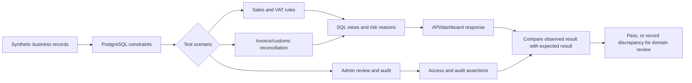
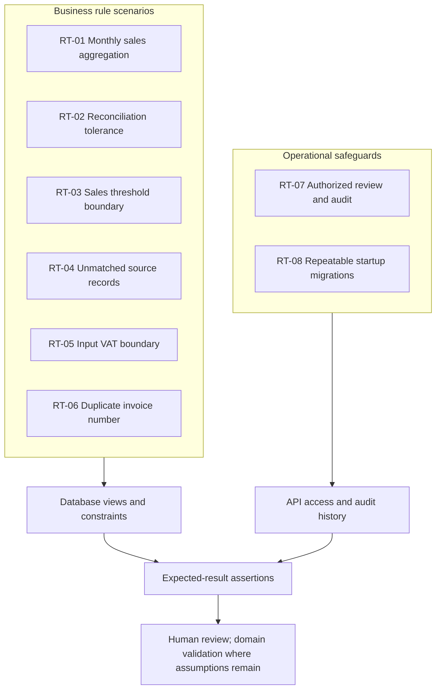

# Test Case Diagrams

These diagrams show the flow and coverage of the synthetic test scenarios. They describe the current prototype and are not policy or production process diagrams.

## Test execution flow

## Scenario coverage map

The RT-IDs correspond to the [recommended executable scenarios](test-scenarios.md#recommended-executable-scenarios). Thresholds and matching behavior remain demonstration assumptions until confirmed against authoritative requirements.
